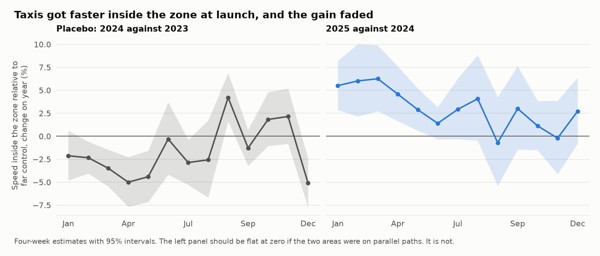
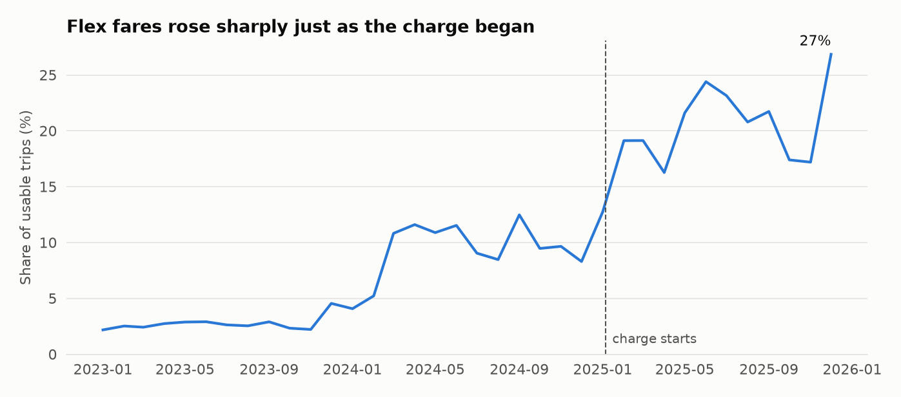
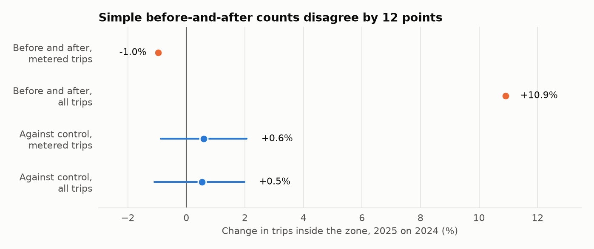
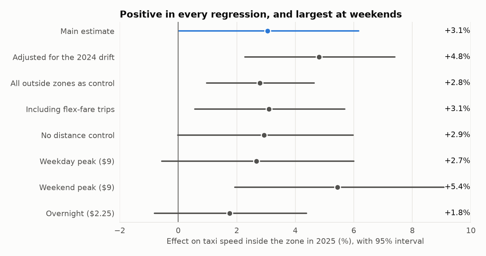

# NYC Congestion Pricing Impact

[](https://github.com/Atharv1414/nyc-congestion-pricing-impact/actions/workflows/tests.yml)

**Did New York's congestion charge speed up traffic?** A causal analysis of 128 million real yellow taxi trips (2023 to 2025), from raw files to a recommendation.

The charge began on 5 January 2025. Drivers entering Manhattan south of 60th Street pay up to $9; a taxi trip adds $0.75.

## Findings

| Question | Answer |
|---|---|
| Did taxis inside the zone get faster? | **+3.1%** in 2025 against zones well outside it (95% interval 0.0% to 6.2%), about 23 seconds on a 12.5-minute trip |
| Did it last? | **+5.9%** in the first quarter, **+1.4%** in the fourth, which is indistinguishable from zero |
| When was it strongest? | Weekend daytime: **+5.4%** (1.9% to 9.1%). The other time bands' intervals include zero |
| Were the two areas comparable beforehand? | Not quite. The same test run on 2024, before any charge, gives **-1.7%** (-3.9% to 0.6%) |
| What if that drift had continued? | The effect would be **+4.8%** (2.3% to 7.4%) |
| Did traffic spill over next door? | No sign of it: streets just north of the zone moved +0.7% (-2.7% to 4.2%) |
| Did people take fewer taxis inside the zone? | No detectable change: **+0.5%** (-1.1% to 2.0%) |

**Bottom line for a decision-maker:** the launch gain looks real, modest and short-lived. I would not tell anyone that the charge raised speeds by a steady 3%, and I would not budget for time savings from the first quarter's figure.



## Three traps in the data

**1. Trip counts cannot be compared before and after.** Flex fares (upfront prices through an app) went from 8% of usable trips in December 2024 to 27% a year later. Counting metered trips says demand inside the zone fell 1.0% in 2025. Counting all trips says it rose 10.9%. Against control zones, the two definitions agree that little changed.





**2. A new vendor reports no trip durations.** Vendor 7 appeared in 2025 with 535,901 records, and every otherwise valid one has the same pickup and drop-off time. They are kept for demand and excluded from speed. Dropping them from both would have understated 2025 demand.

**3. The zone is not published in taxi-zone terms.** I recovered it from the fee itself: in 38 zones at least 77% of same-zone trips paid it, and elsewhere no more than 45% did, with nothing in between. An early version used a 90% cut-off, which quietly moved four zones inside the charge into the control group. A test on the gap caught it.

Every exclusion is a flag, and [the waterfall](data/quality_waterfall.csv) adds up to all 128,202,548 raw trips. `congestion-impact extract` refuses to continue unless each month reconciles to its source file.

## Method

- **Design:** year-over-year difference-in-differences. Each origin-destination pair is compared with itself in the same ISO week and time band of the previous year, and with control pairs in the same week. Comparing the same route stops a change in *which* trips happen from looking like a change in speed. Comparing the same week removes seasonality that differs by area.
- **Control:** trips that start and end in Manhattan, north of the ring next to the zone, and almost never pay the fee. The ring itself is tested separately because drivers might divert there.
- **Estimator:** weighted least squares on 450,000 cells with two sets of fixed effects, swept out by alternating projections ([`fe.py`](src/congestion_impact/fe.py)) and checked against statsmodels.
- **Standard errors:** a delete-one-zone jackknife. Only 11 pickup zones act as control. In 60 simulated panels with no effect, the usual two-way clustered errors rejected 17% of the time instead of 5%; the jackknife rejected 2.5% of 40. It makes the headline interval about 70% wider.
- **Placebo year:** the identical model on 2024 against 2023.
- **Sensitivity:** how large a violation of parallel trends would erase the result, in the spirit of Rambachan and Roth (2023). For the full year, almost any violation does. For the first quarter, it takes one 0.7 times the largest seen in the placebo year.



A **synthetic control** gives a similar size (+3.6%), but I put little weight on it. Its pre-launch fit is poor (4.4% weekly error), because no mix of outside zones reproduces midtown's December, and its placebo p-value is 0.46.

## Limits

- Taxi speeds only. Taxis are not all traffic, and they already paid a separate surcharge from 2019.
- The first-quarter gain is measured against a first quarter of 2024 in which the zone had slowed, so some of it may be a rebound.
- One pre-launch comparison year is a thin basis for judging drift. Both the raw and drift-adjusted figures are shown because the data cannot choose between them.
- Public holidays move between ISO weeks. This is common to both areas but may not affect them equally; December is the clearest case.
- Speed is averaged per trip in logs, so short trips count as much as long ones.

For comparison, [NBER working paper 33584](https://www.nber.org/papers/w33584) uses Google Maps speeds for all traffic and finds trips within or to the zone about 8% faster in the first months. My first-quarter estimate points the same way on a different vehicle population and measure.

## Run it

The 2.2 GB of raw files is not in the repository. The compact panel built from them is, so every number above can be reproduced in about five minutes:

```bash
pip install -e ".[dev]"
congestion-impact analyse   # writes reports/results.json and the charts
pytest                      # 33 tests
```

To rebuild the panel, download `yellow_tripdata_2023-01` to `2025-12` and `taxi_zone_lookup.csv` from the [TLC](https://www.nyc.gov/site/tlc/about/tlc-trip-record-data.page) into `raw/`, then run `congestion-impact extract raw`. It works one month at a time in under 2 GB of memory and resumes if interrupted.

The tests build small worlds with a known effect, drift or spillover and check that the method finds it, or is biased by it, as expected. One test fails if this README quotes a headline number that no longer matches `reports/results.json`.

## Layout

```
sql/                      cleaning rules, speed cells, demand counts, quality waterfall
src/congestion_impact/    extract, panel, fe (estimator), speed, synth, demand, charts, cli
data/                     compact panel and the quality waterfall
reports/results.json      every estimate
tests/                    known-answer simulations, extraction rules, data checks
```

Data: NYC Taxi and Limousine Commission trip records. Code: MIT licence.
